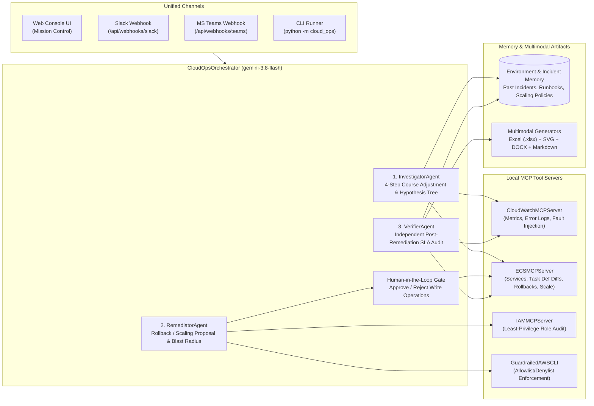

# Cloud Ops Agent — Autonomous Multi-Agent SRE Mission Control (`gemini-3.8-flash`)

**Cloud Ops Agent** is a full-stack, zero-external-dependency-by-default multi-agent SRE & Cloud Infrastructure Operations system powered by **`gemini-3.8-flash`** (with deterministic offline fallback). It combines a **3-agent orchestration pipeline** (`InvestigatorAgent` → `RemediatorAgent` → `VerifierAgent`), **4 local Model Context Protocol (MCP) tool servers** (`CloudWatchMCPServer`, `ECSMCPServer`, `IAMMCPServer`, `GuardrailedAWSCLI`), **hard safety guardrails** with human-in-the-loop approval gates, **persistent Environment & Incident Memory**, **multimodal input/output** (stack trace/log/image ingestion + standalone `.xlsx`, `.svg`, `.docx`, and `.md` Post-Incident Review generators), and an **Executive Dark SRE Mission Control Web Console**.

---

## Architecture Overview



---

## Core Capabilities

### 1. Multi-Agent Collaboration & 4-Step Course Adjustment (`src/cloud_ops/agents/`)
- **Investigator Agent (`investigator.py`)**: Executes a structured 4-step diagnostic workflow with explicit course adjustment:
  - **H1 (`RULED_OUT`)**: Inspects CloudWatch memory RSS (`132MB` vs `512MB` limit) and CPU utilization (`44%`) to rule out container OOM or CPU throttling.
  - **H2 (`RULED_OUT`)**: Inspects CloudWatch logs and regional ALB health checks to rule out AWS regional network partitions.
  - **H3 (`CONFIRMED`)**: Diffs active ECS task definition (`salescreate-api:15`) against the healthy baseline (`salescreate-api:14`), pinpointing configuration/release drift (`RELEASE_VERSION: v2.4.0 -> v2.4.1-bad`) causing `KeyError: 'discount_tier'` (`35.0%` error rate).
  - **Memory Recall**: Matches historical incidents (e.g., `INC-2026-0928`) and standard operating runbooks (`RB-ECS-ROLLBACK-01`).
- **Remediator Agent (`remediator.py`)**: Synthesizes a concrete `RemediationProposal` with exact AWS CLI commands (`aws ecs update-service --cluster cloud-ops-demo-cluster --service salescreate-api --task-definition salescreate-api:14 --force-new-deployment`), blast-radius assessment, and rollback plan. Enforces human approval (`PENDING_APPROVAL`) before any write operation executes.
- **Verifier Agent (`verifier.py`)**: Independently audits post-remediation telemetry and ECS task revisions (`error_rate_pct` dropping from `35.0%` to `0.0%`, active revision restored to `salescreate-api:14`) and triggers automatic fallback if SLA targets are not met.

### 2. Safety Guardrails & IAM Least-Privilege (`src/cloud_ops/mcp_servers/`)
- **`GuardrailedAWSCLI` (`aws_cli_mcp.py`)**: Evaluates every AWS CLI command against strict policy tiers:
  - **Read-Only Allowed**: `aws ecs describe-*`, `aws logs *`, `aws cloudwatch *`, `aws iam get-*`.
  - **Approval-Gated Mutations**: `aws ecs update-service` requires an approved proposal token (`APPROVED_AND_EXECUTED`).
  - **Destructive Denied (`DENIED_DESTRUCTIVE`)**: Commands such as `aws ecs delete-cluster`, `aws rds delete-db-instance`, `aws s3 rb`, or `aws iam AttachRolePolicy AdministratorAccess` are deterministically blocked and recorded in the security audit trail.
- **`IAMMCPServer` (`iam_mcp.py`)**: Audits agent execution roles (`CloudOpsInvestigatorReadOnlyRole`, `CloudOpsRemediatorRole`, `LegacyOverprivilegedOpsRole`) and flags wildcard privilege escalations.

### 3. Persistent Environment & Incident Memory (`src/cloud_ops/memory/store.py`)
- Persists topology, service scaling policies (e.g., off-business hours `20:00–07:00 IST` scaling `salescreate-api` `desired_count` from `2` → `1`), historical resolved incidents, and remediation runbooks in JSON storage (`data/environment_memory.json`).
- Automatically records newly verified incidents so future investigations benefit from prior root causes.

### 4. Multimodal Input & Output (`src/cloud_ops/multimodal/` & `src/cloud_ops/reporting/`)
- **Multimodal Ingestion (`multimodal_ingest.py`)**: Parses attached stack traces, CloudWatch log dumps, task definition JSON/YAML snippets, and dashboard screenshots (`PNG`/`JPEG`/`SVG`, extracting image dimensions and embedded text markers) into structured diagnostic signals.
- **Zero-Dependency Artifact Generators (`reporting/`)**:
  - **Excel Timeline & Telemetry (`excel_generator.py`)**: Generates a valid OpenXML `.xlsx` workbook (`incident_<id>_timeline.xlsx`) with telemetry, hypothesis evaluation, and audit trail sheets.
  - **SVG Architecture & Telemetry Chart (`svg_generator.py`)**: Renders a vector timeline chart (`incident_<id>_metrics.svg`) comparing pre-fix vs. post-fix error rate and p95 latency with deployment and approval markers.
  - **Word Post-Incident Review (`docx_generator.py`)**: Generates a valid OpenXML `.docx` document (`incident_<id>_pir.docx`) with executive summary, root cause analysis, and remediation verification.
  - **Markdown PIR & Runbook (`markdown_generator.py`)**: Exports a complete GitHub-flavored Markdown report (`incident_<id>_pir.md`).

---

## Quickstart (Local Agent + Vertex AI ADC + Remote AWS Account)

### Prerequisites & Authentication
1. **Google Cloud ADC (Vertex AI Gemini Reasoning)**:
   - Uses your Google Cloud Application Default Credentials (`%APPDATA%\gcloud\application_default_credentials.json` from `gcloud auth application-default login`).
   - Automatically connects to Vertex AI (`vertexai=True`, default project `cog01m1hm7b45680madcxrzh1adja`, location `global`) using `C:\googie\.venv\Scripts\python.exe` (`google-genai >= 2.30.1` + `google-auth`).
2. **AWS Account (Hybrid Mode — Local Agent + Remote AWS ECS/CloudWatch)**:
   - Run `python infra/aws_bootstrap.py` once with your AWS credentials configured (`aws configure` or `AWS_PROFILE`) to provision ECR, CloudWatch Log Groups (`/ecs/cloud-ops-demo/*`), and ECS cluster `cloud-ops-demo-cluster`.
   - Pass `-LiveAws` (or set `CLOUD_OPS_LIVE_AWS=true`) so the locally running agent queries live CloudWatch Logs & ECS task definitions on your AWS account.
   - Omit `-LiveAws` to run against the built-in local microservice telemetry simulator with zero AWS charges.

### 1. Launch via PowerShell One-Line Runner (`run_local.ps1`)
```powershell
# Start Web Console & HTTP API on http://127.0.0.1:8000 (Vertex AI ADC + Local Microservice Sim)
.\run_local.ps1 -Mode serve

# Start Web Console & HTTP API connected to your live AWS ECS & CloudWatch account
.\run_local.ps1 -Mode serve -LiveAws

# Run the automated end-to-end CLI demo (with live Vertex AI ADC reasoning)
.\run_local.ps1 -Mode demo

# Run the 10-test unit & HTTP API suite
.\run_local.ps1 -Mode test
```

### 2. Direct Python Commands
```powershell
# Using the virtualenv with google-genai & google-auth installed:
$env:PYTHONPATH="C:\cloud-ops-agent\src"
C:\googie\.venv\Scripts\python.exe -m cloud_ops serve --host 127.0.0.1 --port 8000 --live-aws
```

### 3. Cost Control for Your AWS Account (`infra/aws_teardown.py`)
```powershell
# Scale all 3 ECS services to desiredCount=0 between demos ($0.00/hr Fargate compute)
python infra/aws_teardown.py --pause

# Scale all 3 ECS services back to desiredCount=1 before a live demo
python infra/aws_teardown.py --resume
```

---

## HTTP API Reference

| Method | Endpoint | Description |
| :--- | :--- | :--- |
| `GET` | `/` | Serves the Mission Control Web Console (`index.html`). |
| `GET` | `/static/<file>` | Serves static frontend assets (`styles.css`, `app.js`). |
| `GET` | `/api/health` | Health check, active model (`gemini-3.8-flash`), and service status summary. |
| `GET` | `/api/state` | Full dashboard state: fleet metrics, active/recent incidents, environment memory, IAM roles, and CLI guardrail audit log. |
| `POST` | `/api/chat` | Conversational SRE endpoint accepting `{ "message": "...", "attachments": [...] }`. |
| `POST` | `/api/investigate` | Triggers the 3-agent investigation pipeline for `{ "service": "salescreate-api", "scenario": "bad-release" }`. |
| `POST` | `/api/incidents/<id>/approve` | Approves a pending `PENDING_APPROVAL` remediation proposal, executes the ECS rollback/scale, and runs `VerifierAgent`. |
| `POST` | `/api/incidents/<id>/reject` | Rejects a pending remediation proposal without executing any write operations. |
| `POST` | `/api/incidents/<id>/artifacts` | Generates downloadable `.xlsx`, `.svg`, `.docx`, and `.md` post-incident artifacts. |
| `POST` | `/api/scenarios/inject` | Injects a fault or healthy baseline (`{ "service": "salescreate-api", "scenario": "bad-release" }`). |
| `POST` | `/api/webhooks/slack` | Slack slash-command / event webhook adapter with Block Kit summary. |
| `POST` | `/api/webhooks/teams` | Microsoft Teams webhook adapter with Adaptive Card summary. |
| `GET` | `/artifacts/<filename>` | Serves or downloads a generated post-mortem artifact (`.xlsx`, `.svg`, `.docx`, `.md`). Also mounted at `/api/artifacts/<filename>`. |

---

## Deployment Guide

### Option A: Unified Single-Container Deployment (Docker / Cloud Run)
Build and run both the API server and Web Console in a single container image:

```bash
docker build -t cloud-ops-agent:latest .
docker run --rm -p 8000:8000 \
  -e GEMINI_API_KEY="${GEMINI_API_KEY:-}" \
  cloud-ops-agent:latest
```

### Option B: Split Frontend / Backend Deployment
- **Backend API**: Deploy the container to Google Cloud Run or AWS ECS Fargate exposing `/api/*` and `/artifacts/*`.
- **Static Web Console**: Host `src/cloud_ops/ui/` (`index.html`, `styles.css`, `app.js`) on Firebase Hosting, CloudFront, or Cloud CDN and route `/api/**` and `/artifacts/**` rewrites to the backend service.
